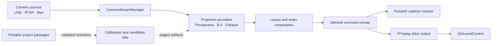

<p align="center">
  
</p>

<p align="center">
  <a href="https://github.com/KevinJiang05/DeepSharkViewStudio/actions/workflows/ci.yml"></a>
  <a href="LICENSE"></a>
  
  
  
</p>

<p align="center"><b>English</b> | <a href="README.zh-CN.md">简体中文</a></p>

DeepShark View Studio is a desktop tool for multi-camera systems on underwater robots. It supports camera preview, calibration, projection experiments, and surround-view stitching, with optional video output to QGroundControl (QGC).

Inspect individual camera views and the stitched canvas, adjust projections and seams, and compare candidate layouts before applying them to the runtime configuration. The interface can switch between English and Chinese.

[Run locally](#run-locally) · [Use your own images](#run-with-your-own-images) · [UI guide](docs/ui_workflow.md) · [QGC video output](docs/qgc_video_payload_service.md) · [Ground station: QGC for GRobot](https://github.com/KevinJiang05/QGC_for_GRobot)

[Screenshot: Realtime Monitor workspace, with the three raw camera views beside the stitched canvas]

## What you can do

- **Inspect camera views:** open image directories, video files, USB cameras, or RTSP streams; compare raw camera views with the stitched result.
- **Calibrate and experiment:** estimate camera intrinsics, adjust projections and seams, and preview candidate layouts without replacing the active calibration.
- **Connect to QGC:** send the stitched canvas through the optional FFmpeg video-output service. See the [integration guide](docs/qgc_video_payload_service.md) for setup.

[Image: comparison of the three raw front-camera frames (front_left / front / front_right) and the stitched panorama they produce]

Video output requires FFmpeg and a valid stitched canvas. RTSP output also requires an RTSP server. DeepShark View Studio produces the video stream; QGroundControl receives and displays it.

## Run locally

Windows is the primary development platform; CI runs on Windows with Python 3.12. From the repository root, create an environment, install the dependencies, and initialize missing local configuration:

```powershell
py -3 -m venv .venv
.\.venv\Scripts\python.exe -m pip install -r requirements.txt
.\.venv\Scripts\python.exe app.py --initialize-configs --preflight-only
```

The initialization step creates only missing local `configs/cameras.yaml` and `configs/network.yaml` files from safe examples. It never overwrites existing local configuration or generates or replaces the tracked calibration. `--preflight-only` checks dependencies and configuration without opening the GUI.

The example configuration contains placeholder RTSP sources. The GUI starts preview automatically, so configure valid sources before expecting live video. To process local images without opening camera streams, use [Run with your own images](#run-with-your-own-images).

Start the GUI:

```powershell
.\.venv\Scripts\python.exe app.py
```

You can also launch the application with:

```powershell
.\StartDeepSharkViewStudio.cmd
```

The launcher checks `DEEP_SHARK_PYTHON`, the repository-local `.venv`, the shared workspace environment, and then standard Python launchers. Every candidate interpreter must provide the full runtime dependency set.

## Run with your own images

No sample image set is bundled with this repository. Place your own images in `samples/input/`, using camera keys in the filenames:

```text
front_left  front_right  front  behind  left  right
```

The script reads `configs/calibration.yaml`. Your images must match the configured cameras, image geometry, and calibration; the tracked calibration is specific to the project hardware. This script processes supplied images; it does not calibrate the cameras.

After installing the dependencies above, run from the repository root:

```powershell
.\.venv\Scripts\python.exe tools\run_image_demo.py
```

The stitched canvas and warped camera views are written to `samples/output/`. Both directories are ignored so local camera imagery is not published accidentally.

## Architecture



The runtime keeps experimental candidates separate from the formal configuration. A selected view, an applied worker configuration, and the effective output state are tracked independently so the UI does not silently claim that an unapplied experiment is active. No experimental candidate is promoted to the formal calibration merely by previewing or saving it.

### Workspaces and runtime views

| Workspace | Capabilities |
| --- | --- |
| **Realtime Monitor** | Preview image directories, USB cameras, video files, or RTSP streams; inspect raw, warped, and stitched views; track camera health and effective runtime state. |
| **Layout Lab** | Author Near and Far layout candidates, compare perspective and fisheye paths, and preview changes without mutating the active calibration. |
| **Calibration & Candidates** | Detect chessboard, ArUco, and ChArUco targets; estimate intrinsics; edit perspective points and seams; export quality reports. |
| **Project Management** | Export, validate, and activate portable project packages; create backups before risky calibration or seam edits; edit local camera configuration and advanced output settings, including the optional FFmpeg stream for QGC. |
| **Diagnostics & Logs** | Read-only operational evidence: redacted logs, runtime provenance, latency, and camera health. |

The tracked calibration defines three camera topologies: a two-camera horizontal layout, the three-camera front panorama used by the current hardware, and a legacy five-camera surround layout. The five runtime views—Far Default, B-2 View, Far Custom, Near Current, and Near Fisheye—are described in the [UI workflow](docs/ui_workflow.md#1-realtime-monitor) and [runtime view contracts](docs/stitch_runtime_modes.md).

## Configuration boundaries

```text
configs/
  calibration.yaml       tracked hardware calibration
  cameras.example.yaml   safe camera-source example
  network.example.yaml   safe output example
  cameras.yaml           local and ignored
  network.yaml           local and ignored
  active_project.yaml    local and ignored
```

Runtime captures, project backups, generated candidates, reports, sample imagery, logs, and UI artifacts are ignored unless deliberately selected for publication. Connection details are redacted before they reach the application log or clipboard.

## Development and tests

Install the development dependencies and run the full suite:

```powershell
.\.venv\Scripts\python.exe -m pip install -r requirements-dev.txt
$env:QT_QPA_PLATFORM = "offscreen"
.\.venv\Scripts\python.exe -m pytest -q
```

GitHub Actions runs the same suite on Windows with Python 3.12. The OpenCV dependency stays on the supported 4.x line because OpenCV 5 introduced API and detection behavior changes that require a separate compatibility pass.

## Project map

```text
DeepSharkViewStudio/
  app.py                         application entry point
  StartDeepSharkViewStudio.cmd   Windows launcher
  configs/                       tracked baseline and safe examples
  deep_shark_studio/
    gui/                         desktop UI and workflow state
    projection/                  perspective, B-2, and fisheye providers
    seam/                        layout, seam, and compositor logic
    project_package/             portable package validation and activation
    qgc/                         optional video output service
  docs/                          workflow and integration documentation
  tests/                         unit, contract, GUI, and regression tests
  tools/                         demos, benchmarks, and UI audit helpers
```

## Documentation

- [Project three-camera RTSP setup](docs/quick_start.md)
- [UI workflow](docs/ui_workflow.md)
- [Runtime view contracts](docs/stitch_runtime_modes.md)
- [Portable project packages](docs/project_package.md)
- [QGC video payload service](docs/qgc_video_payload_service.md)

The Chinese engineering reports in the repository are dated audit snapshots. They preserve the evidence and limitations observed at those stages; the current code, tests, and configuration remain authoritative.

## Related project

[QGC for GRobot](https://github.com/KevinJiang05/QGC_for_GRobot) is the customized QGroundControl application used by the DeepShark underwater robot project. DeepShark View Studio provides a separate workspace for calibration and surround-view development, and can send video to the ground station.

## License

DeepShark View Studio is released under the [MIT License](LICENSE).
