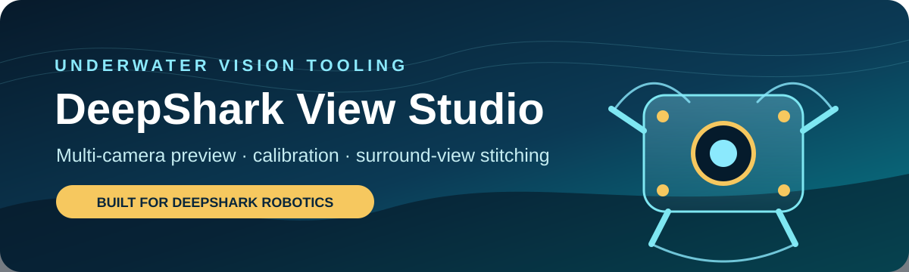
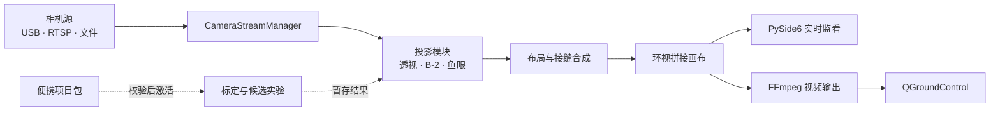

<p align="center">
  
</p>

<p align="center">
  <a href="https://github.com/KevinJiang05/DeepSharkViewStudio/actions/workflows/ci.yml"></a>
  <a href="LICENSE"></a>
  
  
  
</p>

<p align="center"><a href="README.md">English</a> | <b>简体中文</b></p>

DeepShark View Studio 是面向水下机器人多相机系统的桌面工具，支持相机预览、标定、投影实验和环视拼接，并可选择把拼接画面输出到 QGroundControl（QGC）。

可以逐路查看相机画面和拼接画布，调整投影与接缝，先比较候选布局，确认后再应用到运行配置。界面支持中英文切换。

[本地运行](#本地运行) · [用自己的图片运行](#用自己的图片运行) · [界面说明](docs/ui_workflow.md) · [QGC 视频输出](docs/qgc_video_payload_service.md) · [配套地面站：QGC for GRobot](https://github.com/KevinJiang05/QGC_for_GRobot)

[截图：实时监看界面，三路原始相机画面与拼接画布并排显示]

## 能做什么

- **查看相机画面**：接入图片目录、视频文件、USB 相机或 RTSP 流，对照原始画面和拼接结果。
- **标定与实验**：估计相机内参，调整投影和接缝，预览候选布局，不会替换正在使用的标定。
- **对接 QGC**：通过可选的 FFmpeg 视频输出服务发送拼接画面，配置方法见[集成说明](docs/qgc_video_payload_service.md)。

[图片：前向三路相机（front_left / front / front_right）的原始画面，与拼接后的全景画面对比]

视频输出需要 FFmpeg 和有效的拼接画布；RTSP 输出还需要一台 RTSP 服务器。DeepShark View Studio 负责产生视频流，QGroundControl 负责接收和显示。

## 本地运行

主要开发平台是 Windows，CI 在 Windows + Python 3.12 上运行。在仓库根目录创建环境、安装依赖，并初始化缺失的本地配置：

```powershell
py -3 -m venv .venv
.\.venv\Scripts\python.exe -m pip install -r requirements.txt
.\.venv\Scripts\python.exe app.py --initialize-configs --preflight-only
```

初始化只会从安全示例生成缺失的 `configs/cameras.yaml` 和 `configs/network.yaml`，不会覆盖已有的本地配置，也不会生成或替换仓库里跟踪的标定文件。`--preflight-only` 只检查依赖和配置，不打开界面。

示例配置里的 RTSP 地址是占位值。界面启动后会自动开始预览，所以要看到实时画面，需要先配置有效的视频源。如果只想处理本地图片、不连接相机，见[用自己的图片运行](#用自己的图片运行)。

启动界面：

```powershell
.\.venv\Scripts\python.exe app.py
```

也可以用启动脚本：

```powershell
.\StartDeepSharkViewStudio.cmd
```

启动脚本依次查找 `DEEP_SHARK_PYTHON`、仓库内的 `.venv`、共享工作区环境和系统 Python，选中的解释器必须装齐全部运行依赖。

## 用自己的图片运行

仓库不附带样例图片。把自己的图片放进 `samples/input/`，文件名里带上相机名：

```text
front_left  front_right  front  behind  left  right
```

脚本读取 `configs/calibration.yaml`。图片必须和配置中的相机、画面尺寸及标定相匹配；仓库里的标定针对项目自己的硬件。这个脚本只处理已有图片，不做相机标定。

装好上面的依赖后，在仓库根目录运行：

```powershell
.\.venv\Scripts\python.exe tools\run_image_demo.py
```

拼接画布和各路变换后的画面会写到 `samples/output/`。输入和输出目录都被 Git 忽略，避免本地相机画面被误传。

## 架构



运行时把实验候选和正式配置分开管理。当前选中的视图、已应用的配置和实际输出状态分别记录，界面不会把尚未应用的实验显示成"正在生效"。预览或保存候选都不会自动把它提升为正式标定。

### 工作区与运行视图

| 工作区 | 功能 |
| --- | --- |
| **实时监看**（Realtime Monitor） | 预览图片目录、USB 相机、视频文件或 RTSP 流；查看原始、变换后和拼接画面；跟踪相机状态和实际运行状态。 |
| **布局实验**（Layout Lab） | 编辑近景和远景布局候选，比较透视与鱼眼两种投影，预览改动而不影响正在使用的标定。 |
| **标定与候选**（Calibration & Candidates） | 识别棋盘格、ArUco 和 ChArUco 标定板；估计内参；编辑透视点和接缝；导出质量报告。 |
| **项目管理**（Project Management） | 导出、校验和激活便携项目包；在有风险的标定或接缝修改前自动备份；编辑本地相机配置和高级输出设置，包括可选的 QGC 视频流。 |
| **诊断与日志**（Diagnostics & Logs） | 只读的运行记录：脱敏日志、运行来源、延迟和相机状态。 |

仓库里的标定定义了三种相机拓扑：双路水平布局、当前硬件使用的前向三路全景，以及旧的五路环视布局。五个运行视图（Far Default、B-2 View、Far Custom、Near Current、Near Fisheye）的说明见[界面说明](docs/ui_workflow.md#1-realtime-monitor)和[运行视图约定](docs/stitch_runtime_modes.md)。

## 配置边界

```text
configs/
  calibration.yaml       跟踪的硬件标定
  cameras.example.yaml   相机源安全示例
  network.example.yaml   输出配置安全示例
  cameras.yaml           本地文件，被忽略
  network.yaml           本地文件，被忽略
  active_project.yaml    本地文件，被忽略
```

运行截图、项目备份、生成的候选、报告、样例图片、日志和界面产物默认都被忽略，除非特意挑出来发布。连接信息在写入日志或剪贴板之前会脱敏。

## 开发与测试

安装开发依赖并运行全部测试：

```powershell
.\.venv\Scripts\python.exe -m pip install -r requirements-dev.txt
$env:QT_QPA_PLATFORM = "offscreen"
.\.venv\Scripts\python.exe -m pytest -q
```

GitHub Actions 在 Windows + Python 3.12 上运行同一套测试。OpenCV 固定在 4.x：OpenCV 5 改动了 API 和标定板检测行为，需要单独做一轮兼容性适配。

## 目录结构

```text
DeepSharkViewStudio/
  app.py                         程序入口
  StartDeepSharkViewStudio.cmd   Windows 启动脚本
  configs/                       跟踪的基线配置和安全示例
  deep_shark_studio/
    gui/                         桌面界面和流程状态
    projection/                  透视、B-2 和鱼眼投影
    seam/                        布局、接缝和合成逻辑
    project_package/             便携项目包的校验与激活
    qgc/                         可选的视频输出服务
  docs/                          流程和集成文档
  tests/                         单元、约定、界面和回归测试
  tools/                         演示、性能测试和界面检查工具
```

## 文档

以下文档为英文：

- [项目三路 RTSP 相机配置](docs/quick_start.md)
- [界面说明](docs/ui_workflow.md)
- [运行视图约定](docs/stitch_runtime_modes.md)
- [便携项目包](docs/project_package.md)
- [QGC 视频输出服务](docs/qgc_video_payload_service.md)

仓库根目录的中文工程报告是带日期的审计快照，记录的是当时观察到的证据和局限；以当前的代码、测试和配置为准。

## 相关项目

[QGC for GRobot](https://github.com/KevinJiang05/QGC_for_GRobot) 是 DeepShark 水下机器人项目使用的定制版 QGroundControl。DeepShark View Studio 为标定和环视拼接开发提供独立的工作环境，并可以把视频发送给地面站。

## 许可证

DeepShark View Studio 以 [MIT 许可证](LICENSE)发布。
